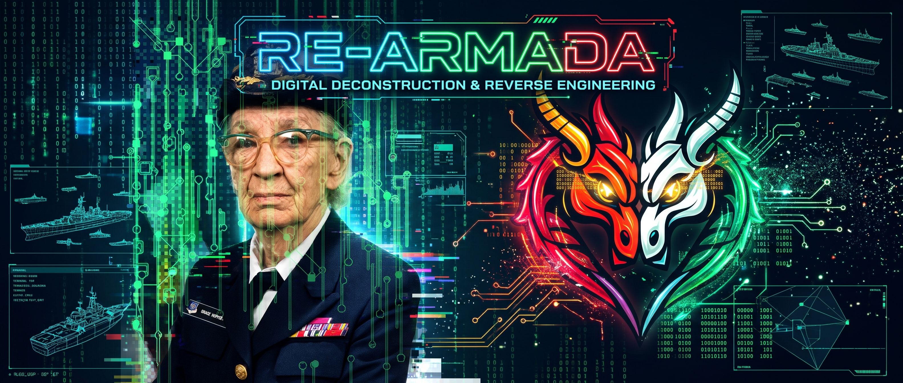

# RE-Armada

**The Reverse Engineering Armada** — three related open-source reverse-engineering projects.

| Project | What it is |
|---|---|
| [**GayHydra**](https://github.com/CryptoJones/GayHydra) | A security-hardened fork of NSA's Ghidra. The proven engine: the Ghidra you know, with the governance, security and testing gaps closed. |
| [**Scylla**](https://github.com/CryptoJones/Scylla) | A reverse-engineering platform built around GayHydra's engine. A durable Rust core holds the analysis, and thin, swappable "heads" expose it: an MCP server for AI agents, a browser head, a CLI, a TUI, an LSP server, and HTTP, GraphQL and RPC gateways. |
| [**AdmiralGrace**](https://github.com/CryptoJones/AdmiralGrace) | A disassembler and decompiler written from scratch in Rust, with a desktop workbench. Named for Admiral Grace Hopper. |

GayHydra is the engine, Scylla is the platform built on it, and AdmiralGrace is a new engine written in Rust.

---

*Proudly Made in Nebraska. Go Big Red! 🌽 https://xkcd.com/2347/*
